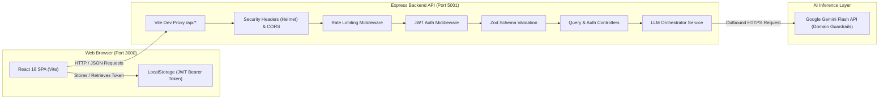

# Husqvarna AI Query Assistant

A full-stack, enterprise-grade AI Query Assistant engineered to explore and query **Husqvarna India Forest & Garden** products (chainsaws, power weeders, Automower®, CEORA™ autonomous turf care), Swedish innovation heritage since 1689, technical specifications, and Husqvarna Group GIS India cloud architecture.

The application is built with a decoupled architecture featuring a **React 18 + TypeScript + Vite** frontend and a **Node.js 22 + Express + TypeScript** backend powered exclusively by **Google Gemini Flash**.

---

## 🏗️ System Architecture



---

## 📋 Prerequisites

Before setting up the project locally, verify that your environment meets the following requirements:

- **Node.js**: `v22.0.0` or higher (verified via `.nvmrc` and `engines` declaration)
- **Package Manager**: `npm` (v10+ recommended) or `yarn` / `pnpm`
- **Google Gemini API Key**: Required for AI query processing (obtain from [Google AI Studio](https://aistudio.google.com/)).

---

## 🚀 Step-by-Step Local Setup

### Step 1: Clone and Configure Environment Variables

The project uses a unified environment configuration file located in the `config/` directory.

1. Copy the example configuration template:
   ```bash
   cp config/.env.app.example config/.env.app
   ```

2. Review and update `config/.env.app` if needed:
   ```ini
   # Server Network & Environment
   PORT=5001
   NODE_ENV=development

   # JWT Security Key (minimum 16 characters)
   JWT_SECRET=husqvarna-gis-eval-jwt-secret-key-2026-secure

   # AI Provider Configuration (Google Gemini)
   GEMINI_API_KEY=your_gemini_api_key_here
   GEMINI_MODEL=gemini-3.5-flash
   LLM_PROVIDER=gemini
   LLM_TIMEOUT_MS=15000

   # Client Settings
   CLIENT_PORT=3000
   VITE_API_URL=http://localhost:5001
   ```

---

### Step 2: Start the Backend API Server

Open a terminal window and start the backend service:

```bash
# 1. Navigate to the server workspace
cd server

# 2. Install backend dependencies
npm install

# 3. Start the server in hot-reload development mode
npm run dev
```

The server will automatically detect `config/.env.app` and start on `http://localhost:5001`:

```
==============================================================
  🌿 Husqvarna AI Query Assistant Server
==============================================================
  🚀 Status:   Running in DEVELOPMENT mode
  🌐 Port:     http://localhost:5001
  🤖 Provider: gemini (API Key Loaded)
  🧠 Model:    gemini-3.5-flash
  🔒 Auth:     JWT Bearer Protected
==============================================================
```

---

### Step 3: Start the Frontend Client

Open a second terminal window and start the Vite development server:

```bash
# 1. Navigate to the client workspace
cd client

# 2. Install client dependencies
npm install

# 3. Start the frontend development server
npm run dev
```

The Vite dev server will initialize at:
- **Local Application URL**: [http://localhost:3000](http://localhost:3000)
- **API Proxy**: Automatically routes all `/api/*` calls to `http://localhost:5001` without cross-origin configuration friction.

---

## 🔍 Verification & Health Checks

Once both services are running:

1. **Verify Backend Health**:
   Open [http://localhost:5001/api/health](http://localhost:5001/api/health) in your browser or run:
   ```bash
   curl -i http://localhost:5001/api/health
   ```
   **Expected Response:** `HTTP 200 OK`
   ```json
   {
     "status": "healthy",
     "timestamp": "2026-10-30T10:00:00.000Z",
     "uptimeSeconds": 42,
     "provider": "gemini",
     "model": "gemini-3.5-flash",
     "realApiKeyConfigured": true,
     "version": "1.0.0"
   }
   ```

2. **Access the Web Client**:
   Navigate to [http://localhost:3000](http://localhost:3000). The web client will automatically:
   - Perform an initial handshake with `/api/health`.
   - Acquire or refresh a JWT Bearer token via `/api/auth/token`.
   - Present the interactive chat interface with suggested queries.

---

## 📡 REST API Specifications & Contracts

All API endpoints follow standardized JSON envelopes for responses and errors.

### Envelope Formats

#### Success Envelope (`200 OK`)
```json
{
  "success": true,
  "data": { ... }
}
```

#### Error Envelope (`4xx / 5xx`)
```json
{
  "success": false,
  "error": {
    "code": "ERROR_IDENTIFIER",
    "message": "Human readable explanation",
    "details": null
  }
}
```

---

### Endpoints

#### 1. System Health Check
- **Route**: `GET /api/health`
- **Access**: Public
- **Description**: Returns live operational status, active LLM provider, and configuration status.
- **HTTP Status**: `200 OK`
- **Response Payload**:
  ```json
  {
    "status": "healthy",
    "timestamp": "2026-10-30T10:00:00.000Z",
    "uptimeSeconds": 120,
    "provider": "gemini",
    "model": "gemini-3.5-flash",
    "realApiKeyConfigured": true,
    "version": "1.0.0"
  }
  ```

---

#### 2. Mint Evaluation JWT Token
- **Route**: `POST /api/auth/token`
- **Access**: Public
- **Description**: Issues a signed JWT Bearer token for authenticating subsequent requests.
- **Request Headers**: `Content-Type: application/json`
- **Request Body (Zod Validated)**:
  ```json
  {
    "userId": "reviewer-user",
    "role": "developer",
    "expiresInSeconds": 3600,
    "isExpiredTest": false
  }
  ```
  | Field | Type | Required | Default | Description |
  |---|---|---|---|---|
  | `userId` | string | Optional | `"reviewer-user"` | User identifier for the JWT claims payload |
  | `role` | enum | Optional | `"developer"` | Allowed values: `"admin"`, `"developer"`, `"viewer"` |
  | `expiresInSeconds` | number | Optional | `3600` | Expiration lifespan (1s - 86400s) |
  | `isExpiredTest` | boolean | Optional | `false` | Convenience flag to issue an already-expired token for testing 401 handling |

- **Response Payload (`200 OK`)**:
  ```json
  {
    "success": true,
    "data": {
      "token": "eyJhbGciOiJIUzI1NiIsInR5cCI6IkpXVCJ9...",
      "tokenType": "Bearer",
      "expiresInSeconds": 3600,
      "userId": "reviewer-user",
      "role": "developer"
    }
  }
  ```

---

#### 3. Submit AI Query
- **Route**: `POST /api/query`
- **Access**: Protected (**Requires JWT Bearer Token**)
- **Description**: Submits natural language queries regarding Husqvarna products. Subject to dedicated rate limiting (30 requests/minute).
- **Request Headers**:
  - `Content-Type: application/json`
  - `Authorization: Bearer <JWT_TOKEN>`
- **Request Body (Zod Validated)**:
  ```json
  {
    "query": "What are the primary features of Husqvarna professional chainsaws and power weeders in India?",
    "model": "gemini-3.5-flash",
    "temperature": 0.3
  }
  ```
  | Field | Type | Required | Validation Constraints |
  |---|---|---|---|
  | `query` | string | **Yes** | Trimmed, 1 to 2000 characters |
  | `model` | string | Optional | Model identifier override (defaults to server config) |
  | `temperature` | number | Optional | Value between 0.0 and 2.0 |

- **Response Payload (`200 OK`)**:
  ```json
  {
    "success": true,
    "data": {
      "query": "What are the primary features of Husqvarna professional chainsaws and power weeders in India?",
      "response": "### Husqvarna India: Professional Chainsaws & Agricultural Power Weeders\n\n...",
      "model": "gemini-3.5-flash",
      "provider": "gemini",
      "usage": {
        "promptTokens": 45,
        "completionTokens": 180,
        "totalTokens": 225
      },
      "latencyMs": 420,
      "timestamp": "2026-10-30T10:01:00.000Z"
    }
  }
  ```

- **Common Error Codes**:
  - `400 BAD_REQUEST`: Invalid input format or empty query.
  - `401 UNAUTHORIZED`: Missing or invalid Bearer token.
  - `401 TOKEN_EXPIRED`: The provided token has expired.
  - `429 TOO_MANY_REQUESTS`: Rate limit exceeded.
  - `502 PROVIDER_NOT_CONFIGURED`: Gemini selected but no API key supplied.
  - `504 GATEWAY_TIMEOUT`: LLM provider request exceeded `LLM_TIMEOUT_MS`.

---

## 🤖 Google Gemini AI Engine & Knowledge Guardrails

The backend directly orchestrates live inferences with **Google Gemini Flash**:

- **Google Generative AI SDK**: Integrates `@google/generative-ai` configured with the authoritative Husqvarna India Forest & Garden knowledge base (https://www.husqvarna.com/in/) and system prompt.
- **Model Support**: Defaults to `gemini-3.5-flash` (configurable via `GEMINI_MODEL`).
- **Resilience & Timeout Safety**: Configured with an `AbortSignal` enforcing `LLM_TIMEOUT_MS` to prevent hanging upstream connections.
- **Strict Domain Guardrails**: Specialized system prompt that rejects off-topic inquiries outside the Husqvarna Forest & Garden and Husqvarna Group GIS scope.

---

## 🛡️ Security Architecture & Guardrails

- **JWT Authentication**: Enforces signed cryptographic verification on all AI interaction endpoints.
- **Input Sanitization & Schema Validation**: Strict parameter validation using `Zod`. Rejecting inputs larger than 2,000 characters to prevent buffer and token exhaustion attacks.
- **Rate Limiting**:
  - General endpoints: 100 requests per 15-minute window.
  - Query endpoint: 30 requests per 1-minute window.
- **Security Headers**: Standardized OWASP protections configured via `Helmet`.
- **CORS Protection**: Restricted and verified origin handling.

---

## 📁 Repository Structure

```
.
├── config/
│   ├── .env.app                # Local active environment config
│   └── .env.app.example        # Environment template & reference
├── client/                     # Frontend Application (React 18 + Vite)
│   ├── src/
│   │   ├── components/         # Modular UI (ChatWindow, Header, ErrorBoundary)
│   │   ├── services/           # ApiService and Token/Chat Storage
│   │   ├── types/              # Shared TypeScript definitions
│   │   ├── App.tsx             # Root application orchestrator
│   │   └── App.css             # Scoped styles and themes
│   ├── package.json
│   └── vite.config.ts          # Vite configuration with /api reverse proxy
├── server/                     # Backend API Service (Node 22 + Express)
│   ├── src/
│   │   ├── config/             # Environment validation (env.ts, knowledge)
│   │   ├── controllers/        # Express route handlers (auth, query, health)
│   │   ├── middleware/         # Auth, RateLimiter, Validation, Error middlewares
│   │   ├── routes/             # Express route declarations
│   │   ├── schemas/            # Zod validation schemas
│   │   ├── services/           # LLM orchestrator & Gemini provider
│   │   ├── app.ts              # Express application factory
│   │   └── index.ts            # Server entrypoint and graceful shutdown
│   ├── package.json
│   └── tsconfig.json
├── Docker/                     # Container definitions and compose stack
├── DEPLOYMENT.md               # AWS ECS Cloud Architecture Documentation
└── README.md                   # Project overview & local run guide (this file)
```

---

## 🛠️ Available NPM Scripts

### Backend (`cd server`)
| Command | Action |
|---|---|
| `npm run dev` | Starts server with live auto-reload via `tsx watch` on port `5001` |
| `npm run build` | Compiles TypeScript into `dist/` |
| `npm start` | Executes compiled production JavaScript (`node dist/index.js`) |

### Frontend (`cd client`)
| Command | Action |
|---|---|
| `npm run dev` | Launches Vite dev server with Hot Module Replacement (HMR) on port `3000` |
| `npm run build` | Compiles TypeScript and builds production assets into `dist/` |
| `npm run preview` | Locally previews the production build |

---

## 💡 Troubleshooting & FAQ

### 1. `PORT 5001 already in use`
- If port 5001 is occupied, change `PORT=5002` in `config/.env.app`, and update `client/vite.config.ts` target proxy or `VITE_API_URL`.

### 2. `Invalid environment configuration` error on server start
- Ensure `config/.env.app` exists and contains a `JWT_SECRET` with at least 16 characters.

### 3. Node version incompatibility
- If you encounter runtime syntax errors, ensure you are running Node 22+:
  ```bash
  node -v
  # Should output v22.x.x
  # If using nvm:
  nvm use
  ```
